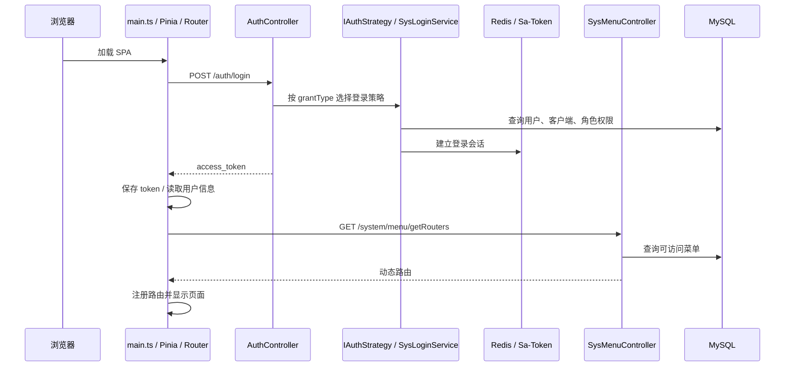
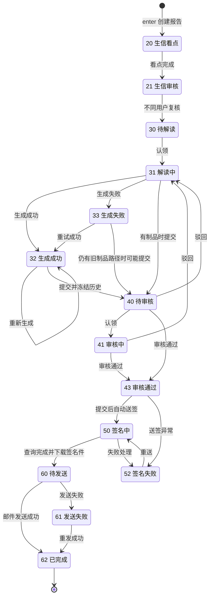
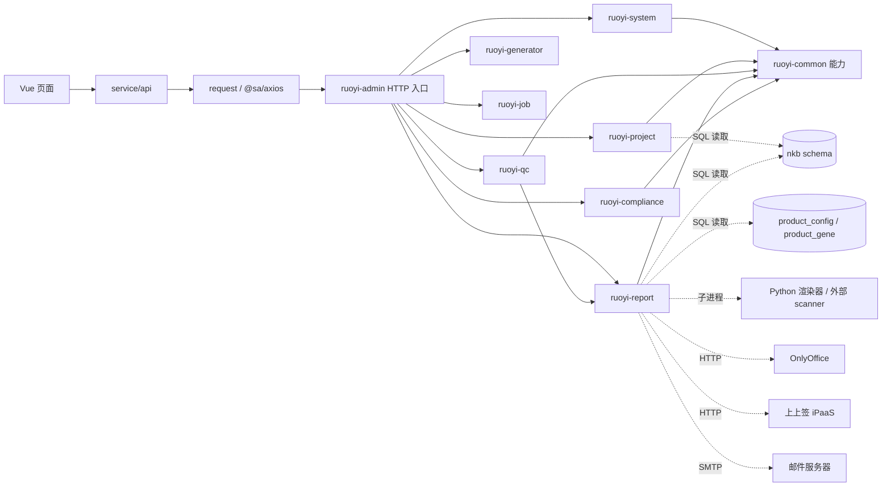
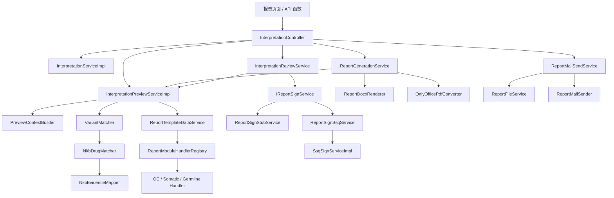
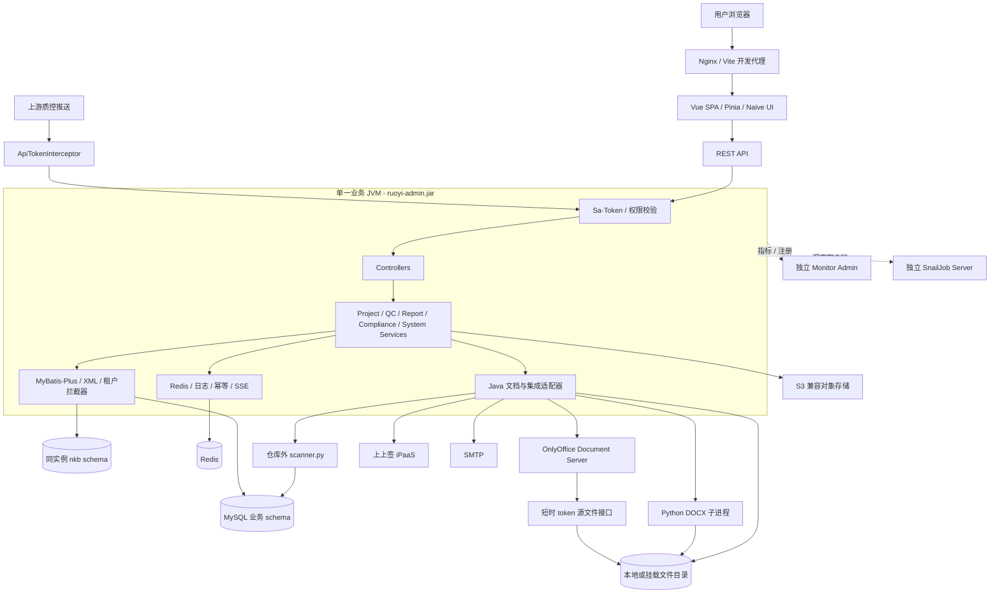
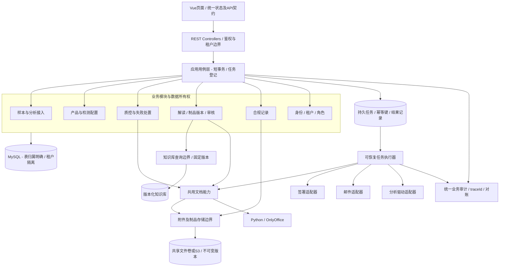

# Project Overview

审查日期：2026-10-17（Asia/Shanghai）。源码基线：`5925387`，分支 `refactor/report-service-layer`。审查开始时工作区无未提交改动。

本项目是药企 NGS 报告运营管理系统，当前形态为 **Vue 管理前端 + Spring Boot 模块化单体 + MySQL/Redis + 文档及签署外围服务**。它已经实现项目产品配置、湿实验/生信质控、通知单、样本信息、报告解读及交付、合规文档等业务，不能再按“只有模板脚手架”理解。

判断依据为实际注册的 Maven 模块、Controller、服务方法、Mapper XML、SQL 和前端 API，而非目录命名。后端仍是一个 `ruoyi-admin.jar` 承载业务，没有发现业务微服务、消息总线或独立的工作流引擎；流程转移分布在 Service 和 SQL 条件更新中。[模块注册][B03]、[启动模块依赖][B02]、[状态定义][B18]。

| 项目 | 当前证据 |
|---|---|
| 后端 | Java 17、Spring Boot 3.5.16、RuoYi-Vue-Plus 5.6.2、MyBatis-Plus、Sa-Token、Undertow；见[父 POM][B01] |
| 前端 | Vue 3.5.34、TypeScript 6.0.3、Vite 8.0.12、Vue Router 5.0.7、Pinia 3.0.4、Naive UI 2.44.1；见[package.json][F01] |
| 数据库 | 应用配置使用 MySQL JDBC；仓库 Compose 镜像为 `mysql:5.7.26`，不是根规范描述的 MySQL 8；见[Compose][D01]、[生产配置][C03] |
| 数据隔离 | 共享数据库、业务表 `tenant_id`、MyBatis 租户拦截器；默认租户 `000000` 具有平台可见性，详见风险 P07 |
| 文档生成 | Java 组装 JSON → Python/docxtpl/Jinja2 渲染 DOCX → OnlyOffice 转 PDF |
| 交付 | 上上签 iPaaS 网关签署 → 签名 PDF → SMTP 邮件；邮件配置取自数据库，独立于全局 `mail.enabled` |

## 审查范围与结论可信度

- 扫描全部 1,725 个 Git 跟踪文件的结构、扩展名、入口和集成关键词；其中后端 905 个、前端 719 个。未将 `target/`、`node_modules/`、`dist/` 当作源码。
- 重点逐段阅读启动、鉴权、租户、请求封装、业务入口服务、跨表 Mapper、报告生成/审核/签署/发送、附件处理、构建与部署配置。公共模板模块结合代表实现和依赖声明审查，并非逐行审计所有源码。
- **已确认**表示直接存在于代码/配置或本次命令输出；**风险推导**表示由调用顺序与失败条件推导，未进行攻击或并发复现；**待验证**表示需要实际数据库、服务或部署环境。
- 本文是整体架构审查，不是合规认证、完整渗透测试或生产可用性证明。没有修改业务代码、配置或 SQL，也没有连接生产系统。

## 与现有说明的差异

[根 AGENTS.md][R01] 关于“业务尚未实现、无业务 DDL、用户/菜单为纯前端 demo”的描述已落后：实际存在四个新增业务模块、`script/sql/business/` 和多批迁移；[用户 API][F12]、[菜单接口][B28]已连接后端。[前端 README][R03]仍把安全框架写为 Spring Security，而实际使用[Sa-Token SecurityConfig][B05]。版本以依赖文件为准。

原始[Project Workflow.png][R04]描述的规则决策、全过程电子记录、交付归档、CSV/3Q 验证属于目标范围；当前代码覆盖其中一部分。没有证据证明已实现全流程自动编排、FASTQ 完整性校验、归档搬迁或完整 URS→IQ/OQ/PQ→RTM 追溯。不能把流程图当作实现证明。

# Directory Structure

```text
admin/
├─ AGENTS.md                       仓库入口规范，部分现状已失真
├─ ai-rules/                       可读性、评审、协作、数据库、提交规则
├─ ai-templates/                   前后端 CRUD / 建表模板
├─ tools/                          静态闸门、CRUD 脚手架、提交校验
├─ docs/context/                   顶层流程图、参考资料和数据文件
├─ template-backend/
│  ├─ pom.xml                      Maven 聚合、依赖版本、构建 Profile、测试筛选
│  ├─ ruoyi-admin/                 HTTP 启动、登录策略、机器推送鉴权、集成测试
│  ├─ ruoyi-modules/
│  │  ├─ ruoyi-system/             租户/用户/角色/菜单、OSS、监控数据
│  │  ├─ ruoyi-project/            产品配置、产品基因
│  │  ├─ ruoyi-qc/                 阈值标准、湿实验/生信质控、失败通知
│  │  ├─ ruoyi-report/             样本、流转、解读匹配、模板、制品、签署、邮件
│  │  ├─ ruoyi-compliance/         3Q 文档、开发记录、验证记录和附件
│  │  ├─ ruoyi-generator/          代码生成器
│  │  └─ ruoyi-job/                SnailJob 执行器，当前有账单/分片等示例任务
│  ├─ ruoyi-common/                基础能力聚合：core、mybatis、security、redis 等
│  ├─ ruoyi-extend/                独立监控服务、SnailJob 服务
│  ├─ script/sql/                  基础库、业务 DDL、增量迁移
│  ├─ script/tests/                DOCX 渲染、租户回归、Checkstyle 回归
│  ├─ script/docker/               基础设施 Compose、Nginx/Redis 配置
│  └─ docs/backend-code-standard.md
└─ template-frontend/
   ├─ package.json / pnpm-lock.yaml / pnpm-workspace.yaml
   ├─ build/                       Vite 插件、API 代理、路由生成
   ├─ src/main.ts / App.vue         应用入口和全局 Provider
   ├─ src/router/                  静态路由、动态路由转换和守卫
   ├─ src/store/                   用户、路由、主题、页签、通知状态
   ├─ src/service/                 HTTP 请求封装与按业务划分的 API
   ├─ src/views/                   system/project/qc/report/compliance 等页面
   ├─ src/hooks/                   表格、表单、权限、下载等公共行为
   ├─ src/typings/                 API、页面和环境类型
   ├─ packages/                    axios、alova、hooks、utils、materials 等工作区包
   └─ DESIGN.md / UX-CONTRACT.md    前端设计和能力归属契约
```

以上是源码结构摘要。实际运行请求使用 `@sa/axios`；仓库有 `packages/alova` 并不代表业务请求同时使用两套 HTTP 客户端。[请求入口][F06]、[工作区声明][F02]。

# Module Responsibilities

## 后端业务与组装层

| 模块 | 实际职责和主要实现 | 数据与边界 |
|---|---|---|
| `ruoyi-admin` | `DromaraApplication.main()` 组装所有业务；`AuthController.login()` → `IAuthStrategy.login()`；`ApiTokenInterceptor` 为上游固定 token 调用建立短期身份 | 依赖全部业务模块；不是只含启动类的空壳。[B02][B04][B06][B07] |
| `ruoyi-system` | `SysUserServiceImpl` 管理用户并校验租户；`SysMenuController.getRouters()` 提供动态菜单；角色权限供 Sa-Token 使用；`SysOssServiceImpl` 对接 OSS | 用户、角色、菜单、租户和存储配置；部分表为平台共享。[B52][B53][B28][B29] |
| `ruoyi-project` | `ProductConfigServiceImpl` 管理产品和删除保护；`ProductGeneServiceImpl` 提供基因检索/导入/关联；`ProductGeneMapper.xml` 查询 `nkb.ncbi_gene` | `product_config`、`product_gene`；知识库通过 SQL 跨 schema 访问，而非远程 NCBI API。[B30][B31] |
| `ruoyi-qc` | `QcStandardServiceImpl` 维护阈值；湿实验、生信服务 `receive()` 解析归属、更新指标、判定状态；`QcFailedNotifyServiceImpl` 预填、生成和签署通知单 | `qc_standard`、`wet_lab_qc`、`bioinfo_qc`、`qc_failed_notify`；通过 Maven 直接依赖 report 的文档和签署实现。[B32][B33][B34][B35] |
| `ruoyi-report` | `SampleInfoServiceImpl` 样本录入/Excel 导入；`SampleFlowServiceImpl` 工作队列与认领；`InterpretationServiceImpl` 批次、报告和位点；预览/知识匹配/模板 Handler；生成、审核、签署、邮件 | `sample_file`、`analysis_data`、`analysis_report`、`data_file_status`、`file_*`、`history_*`、模板与邮件表；职责最集中。[B09]—[B26] |
| `ruoyi-compliance` | `ComplianceDocServiceImpl`、`DevLogServiceImpl`、`ValidationRecordServiceImpl` 管理记录和本地附件 | 已实现记录 CRUD 不等于完整 3Q 验证流程。附件不走 `SysOssServiceImpl`。[B36][B37][B38] |
| `ruoyi-generator` | `GenController` → `GenTableServiceImpl` → 元数据/Velocity 模板，生成代码 | 开发辅助能力；不在 NGS 报告主链路中。[B39] |
| `ruoyi-job` | SnailJob 注解执行器；例如 `WechatBillTask.jobExecute()` 为模拟账单任务 | 已有调度底座；未发现用它承载报告生成、签署补偿或自动归档的证据。[B40] |

## 基础能力层

`ruoyi-common` 是多个可组合 jar 的聚合，核心能力由依赖及 `META-INF/spring/...AutoConfiguration.imports` 装配，不是单一业务服务。

| 能力组 | 关键机制 | 架构含义 |
|---|---|---|
| core / json / web | `R`、通用异常、Spring 工具、Jackson、`GlobalExceptionHandler` | 统一 JSON、异常与基础服务接口。[B42] |
| mybatis / satoken / security | `MybatisPlusConfig`、`TenantLineHandlerImpl`、`TenantContext`、`SecurityConfig` | 租户过滤、分页、乐观锁插件、认证及权限拦截；插件存在不代表所有自定义 UPDATE 自动获得并发保护。[B05][B08][B43][B52] |
| redis / idempotent / ratelimiter | Redisson、缓存、重复提交与限流能力 | Redis 是会话及横切机制的重要依赖，防重复提交不能替代业务幂等 |
| log / sensitive / encrypt | `LogAspect`、字段脱敏、API 加解密、可选数据库加密 | 日志与数据保护依赖注解和配置，不应推定所有医疗字段已受保护。[B44][C01] |
| oss / excel / mail / sms / social | S3 SDK、FastExcel、邮件、短信、JustAuth | 属于可配置集成；依赖存在不代表供应商已配置或已启用。[B29][C02][C03] |
| sse / websocket / job / doc / translation | SSE、可选 WebSocket、SnailJob、Springdoc、通用服务查询转换 | 资源推送/运维/开发支撑，不是业务事件总线 |

`SysUserServiceImpl` 实现 common-core 的 `UserService` 接口，是已有的反向依赖边界；值得保留。相对地，QC 对报告实现类的依赖没有类似隔离。

## 前端层

页面组件负责交互、分页表格与表单；`src/service/api/*` 负责 URL、参数和响应类型；`src/service/request/index.ts` 统一身份头、客户端 ID、重复提交、加解密和错误显示。Pinia `auth` 与 `route` 共同初始化用户和可访问页面。[F06][F07][F08]。

报告页面由列表和详情页签组成，预览、位点、审核、发送组件继续调用同一业务 API。状态展示映射放在 `interpretation-status.ts`，流转页签权限另在 `sample-flow-tabs.ts` 定义；后端也维护对应状态及权限映射。[F10][F11][F15][B17][B18]。

# Startup Flow

## 后端入口

主业务入口是 [DromaraApplication.java][B04] 的 `main(String[])`：创建 `SpringApplication`、设置 `BufferingApplicationStartup(2048)`、运行 Spring 容器。`ruoyi-admin/pom.xml` 将业务及公共 jar 打入可执行包，Dockerfile 最终执行 `java -jar app.jar`。[B02][D02]。

1. Maven Profile 及资源过滤把 `@profiles.active@` 写入 `application.yml`。父 POM 默认激活 `dev`，同时定义 `local`、`prod`；仓库实际只有基础/dev/prod YAML，不能假设存在 `application-local.yml`。[B01][C01]
2. Spring 加载基础配置、Profile 配置及环境覆盖；HTTP 默认 8080、context-path `/`，实际部署可覆盖端口。[C01]
3. 自动配置初始化数据源、Redis/Redisson、MyBatis Mapper/插件、Sa-Token、日志和资源接口。主业务模块在同一容器和同一 JVM 中协作。
4. `MybatisPlusConfig` 按租户过滤→分页→乐观锁顺序注册插件。匿名访问业务表缺少租户身份时拒绝；共享表和显式可信上下文例外。[B08][B43]
5. `ApiTokenConfig` 将固定 token 拦截器设为最高优先级，先建立机器身份；随后 `SecurityConfig` 检查登录态和客户端 ID，Controller 注解检查权限。[B05][B06]
6. 根据 `report.sign.provider` 选择 `ReportSignStubService` 或 `ReportSignSsqService`：基础配置默认 stub，prod 默认 ssq。没有实际环境值，不能断言当前部署使用哪个通道。[B20][B21][C01][C03]

另外两个独立入口为 [MonitorAdminApplication.main()][B45] 和 [SnailJobServerApplication.main()][B46]。它们是运维与调度服务，不是业务微服务；各自拥有配置和 Dockerfile。

## 前端入口

`index.html` 加载 [src/main.ts][F03]；`setupApp()` 初始化 loading、NProgress、离线图标、Dayjs，创建 Vue 实例，安装 Pinia，等待 Router ready，安装国际化和版本通知，挂载 `#app`。`App.vue` 提供 Naive UI 主题、语言、全局 Provider 和 `RouterView`。[F04]。

`createRouteGuard()` 先初始化常量路由，再根据 token 初始化用户和权限路由。动态模式中 `initDynamicAuthRoute()` 请求 `/system/menu/getRouters`，转换后注册到 Vue Router；菜单与按钮可见性不能替代后端权限判断。[F05][F08][F09]。

开发时 Vite 默认监听 9527；`createViteProxy()` 按环境配置代理并移除 API 前缀。生产参考配置由 Nginx 提供 SPA fallback，并将 `/prod-api/` 转发至 8080/8081 两个后端。[F13][D03]。



# Core Data Flow

## 1. 样本与上游分析数据

`SampleInfoController` → `SampleInfoServiceImpl` → `sample_file`，支持手工维护和 Excel 导入。`importExcel()` 逐行收集失败；`saveOrUpdateBySubbarcode()` 对曾删除的同编号样本恢复后更新。删除保护通过 `SampleInfoMapper.countWetLabQcBySubbarcode()` 跨模块查询质控引用。[B09][B47]。

分析数据由仓库外的 `scanner.py` 驱动：`analysis_data` 是分析批次，`data_file_status` 记录文件及驱动状态，`file_Somatic_SNV_Indel`、`file_CNV`、`file_Fusion`、`file_CR_ALL`、`file_qc` 等保存解析结果。表结构在[报告业务 DDL][S01]，Java 通过 `InterpretationMapper` 读取。仓库没有 scanner 实现，所以初次扫描触发、解析质量、幂等与租户写入规则不能在本仓完整验证。

人工重新驱动链：`fetchRedriveInterpretationFile()` → `InterpretationController.redriveFile()` → `InterpretationServiceImpl.redriveFile()` → `ClusterDriverInvoker.invokeFile(filePath)` → 外部脚本写数据库 → Java 重新读文件/批次状态。[F10][B10][B11][B27]。

## 2. 质控与失败通知

上游请求命中配置的 `/qc/bioinfo/receive` 或 `/qc/wetLabQc/receive`，固定 token 拦截器仅在 token、路径、开关均匹配时建立身份；仍需后续权限校验，并不是匿名放行。[B06][C01]。

- 生信 `receive()`：样本编号→`sample_file.customer_name`→启用中的 `sys_tenant`→`TenantContext.withTenant()`→指标新增或更新。[B32][S02]
- 湿实验 `receive()`：样本编号→`sample_file.tenant_id`→切换租户→合并已有非空指标→保存。[B33][S03]
- 两处 `judgeStatus()` 读取本类目 active 标准，按 `qc_param` 找指标并比较 min/max；越界为 `failed`，可比项全达标为 `passed`，无可比项为 `pending`。当前历史状态不因阈值修改而自动重算。
- `QcFailedNotifyServiceImpl.prefill()` 组合样本、质控失败描述和历史通知；`generate()` 写 JSON、渲染 DOCX、尽力转 PDF、登记通知并回写质控通知状态；`sign()/refreshSign()` 接入上上签。[B34]

质控状态与报告驱动状态是不同体系。已读报告入口中未见将 `wet_lab_qc/bioinfo_qc.status` 作为全链路统一准入条件的证据；是否允许不合格样本进入正常报告流程，需要结合实际业务规则补验。

## 3. 报告解读、知识匹配与冻结

`InterpretationServiceImpl.enter()` 按 `analysisId` 找可复用未完成报告；没有则创建状态 20 的 `analysis_report`，复制产品/批次信息并取样本癌种。`loadContext()` 校验报告与批次关系，从 `sample_file` 映射 LIMS 字段，必填缺失作为 errors，非关键缺失作为 warnings。[B11]。

预览 `InterpretationPreviewServiceImpl.preview()` 优先读取模板 ID 匹配的已生成 JSON，否则调用实时组装。实时路径为 `PreviewContextBuilder`→`VariantMatcher`→`NkbDrugMatcher/NkbDiseaseScopeResolver`→`ReportTemplateDataService`→模板模块 Handler。[B12][B13][B14][B15][B16]。

`NkbEvidenceMapper.xml` 直接查询 `nkb.disease`、`nkb.gene_variant`、药物、证据、试验等表。知识库是同一 MySQL 实例下的另一 schema，读取时用 `TenantContext.withoutTenant()`；不是 LLM 生成的解读，也没有独立知识库 API。匹配优先复用 `history_somatic/history_germline` 的冻结结果，首次匹配只在提交审核时落历史。[B13][B48]。

模板扩展是真实存在的：`ReportModuleHandlerRegistry` 自动收集 `ReportModuleHandler`，检查重复编码，按 `module_code` 选取流水线；已有 QC、体细胞、胚系三种 Shengyu Handler。新增模板行为优先扩展这里，不应再加第二套中心分支。[B16]。

## 4. 制品生成、审核、签署与邮件

`ReportGenerationService.generate()` 检查状态→重新组装预览→确定模板和文件名→原子写 JSON→Python 渲染 DOCX→OnlyOffice 转 PDF→更新制品路径→写生成状态。每次生成新文件，失败有本次制品清理；PDF 失败允许保留 DOCX。[B19]。

`InterpretationReviewService.submit()` 要求存在制品路径，调用 `freezeHistory()` 再以条件 UPDATE 转待审核；`approve()/reject()` 阻止产出人自审。审核通过事务提交后触发送签，送签失败尝试写 52，避免回滚审核结果。[B17]。

真实签署 `ReportSignSsqService.submit()` 调网关创建合同后记流程号和状态 50；刷新/回调查询通道，完成则下载签名 PDF 并转 60。`InterpretationController.signCallback()` 有内部权限校验，不能直接当作已实现的第三方匿名 webhook；真实自动回调的路由、验签、网络对接仍待验证。当前可使用受权刷新接口同步状态。[B10][B20][B22]。

`ReportMailSendService.send()` 校验 60/61→加载数据库 SMTP 配置→插入 SENDING 日志→发邮件→SUCCESS/FAILED 日志及报告状态更新；成功为 62。附件优先签名 PDF，其次转换 PDF，再次 DOCX。[B23][B24][B25]。这是业务“完成”标记，未见由此执行物理归档搬迁。



图按实际方法及 SQL 绘制。常量 42/53 存在，但当前驳回直接回到 31，真实签署成功直接更新 60；不把常量注释中的所有瞬时态画成必经持久态。[B17][B18][B20][S04]。

# Dependency Graph

实线为已确认的编译依赖或方法调用；虚线为数据/外部集成依赖。图省略部分 common jar。



`report` 没有通过 Maven 依赖 `project`，但 `ReportTemplateMapper.xml` 直接读产品表；`SampleInfoMapper.xml` 又直接查湿实验质控表。**没有编译环并不代表没有数据耦合**。[B31][S05][B47]。



# Architecture Diagram

当前架构如下；外部 scanner 与实际生产部署不在本仓控制范围内。



数据库与文件系统是两个独立持久化边界；Spring 事务不能回滚已经生成的文件、已创建的签署合同或已经发出的邮件。当前实现采用局部清理、状态回写和人工重试，尚无统一的持久任务/补偿日志。

# External Dependencies

| 类别 | 已确认依赖与调用点 | 配置及验证边界 |
|---|---|---|
| 主数据库 | MySQL JDBC/Hikari、MyBatis-Plus，业务 schema 默认 `ry-vue` | `application-dev/prod.yml`；本次 Docker 不可用，未验证真实表结构、索引、SQL 执行计划 |
| 知识数据库 | `NkbEvidenceMapper.xml`、`ProductGeneMapper.xml` 中 `nkb.*` | 同实例跨 schema；[nkb-README][S06]注明 dump 不入 Git，重新部署需要另行取得数据 |
| Redis | Redisson、Sa-Token 会话、缓存、锁与横切功能 | dev/prod YAML；未连接实际 Redis |
| 文件系统 | 合规附件目录；`report.artifact.root`；模板目录；渲染脚本和日志；上游文件根目录 | 数据库保存绝对路径，默认存在 Linux 容器路径；需要挂载、备份、权限和空间管理 |
| S3/MinIO | `SysOssServiceImpl`→`OssFactory/OssClient`→AWS S3 SDK | 通用上传能力；报告和合规附件目前主要直接落本地文件，并非统一 OSS |
| Python | `ReportDocxRenderer`→打包的 `render_report_docx.py`→docxtpl 0.20.1/Jinja2 3.1.6 | [requirements 文件][P02]；渲染脚本随 jar 打包，Python 解释器及库需运行环境提供 |
| 外部 scanner | `ClusterDriverInvoker` 启动配置路径下的 `scanner.py` | 默认路径由 `driver.*` 给出，源码不在 Git 跟踪文件中；脚本自身写库及其依赖不可完整审查 |
| OnlyOffice | `OnlyOfficePdfConverter`→`/ConvertService.ashx`→返回 FileUrl 下载 PDF | `onlyoffice.*`；Document Server 还要反向访问短时 token 源文件接口 |
| 上上签 | `SsqSignServiceImpl`→OAuth token、关键字定位、送签、状态查询、下载签名件 | `ssq.*`、`report.sign.provider`；本次未调用真实网关 |
| SMTP | `ReportMailSender` 使用 `JakartaMail` 和数据库 `ReportMailConfig` | 与 `mail.enabled=false` 并不冲突：此发信器自行创建账号对象；本次未发信 |
| 短信/社交登录 | sms4j、JustAuth、登录策略及 YAML 示例供应商配置 | 属于可选能力；不能由示例配置断言所有供应商已接通 |
| 运维服务 | Monitor Admin、SnailJob Server | dev/prod 默认启用客户端；是额外部署依赖 |
| AI/LLM | **未发现业务运行时集成** | 业务源码、POM、package 和 YAML 的定界关键词扫描仅命中 `.claude/.codex` 开发代理配置，不属于产品 LLM 能力 |
| FFmpeg/媒体 | **未发现 FFmpeg、ffprobe、MoviePy 或媒体转码链** | 实际处理链为 Excel/JSON/DOCX/PDF；不能将文档转换归为媒体转码 |

这些结论针对仓库声明与调用点；没有读取线上环境变量、数据库配置行或外部 scanner，不能排除仓库外服务另有依赖。

# Current Problems

严重度 P1 表示优先处理的数据完整性/隔离/关键流程风险；P2 表示维护与可靠性问题。以下均未在本次修改。

## P01 · P1：合规附件隔离只覆盖数据库行，未覆盖物理内容【已确认】

[ComplianceDocServiceImpl.uploadFile():99][B36]、[DevLogServiceImpl.uploadFile():87][B37]、[ValidationRecordServiceImpl.uploadFile():87][B38]按原文件名写入各自固定公共目录，明确允许覆盖。路径没有租户 ID、记录 ID 或内容版本；下载先查本租户记录，再按该记录的文件名读同一公共目录。租户 A 与 B 上传同名文件时，即使记录隔离，也会读到被覆盖后的内容；同租户旧版本同样被覆盖。建议存储键包含租户和不可变版本，原文件名只作展示。

## P02 · P1：审核冻结结果没有绑定已生成制品快照【风险推导】

[ReportGenerationService.generate():89][B19]实时调用 `buildPreview()` 生成文件；[InterpretationReviewService.submit():83][B17]随后调用 `freezeHistory()`；[freezeHistory():237][B12]又执行 `assemble(bo, true)`实时匹配。没有校验生成 JSON 与冻结历史的输入版本/内容 hash。期间知识库、位点状态、人工改靶或提交参数变化，可导致历史与已生成报告不一致。预览缓存又只判断模板 ID 和文件存在，不校验全部输入版本。建议将生成快照设为唯一审核对象，冻结直接取该快照并校验 hash。

## P03 · P1：生成状态更新缺少并发保护，失败可能留下失效路径【已确认实现；竞态待复现】

`generate()`只在开始检查一次状态。`InterpretationMapper.xml:139` 的 `updateReportGenerated` 和 `:776` 的 `updateReportArtifact`最终仅按报告 ID/删除标记更新，不带来源状态或版本。两个生成任务、生成与送审交叠时，后到任务可能覆盖新状态或制品指针。路径登记后再写成功状态，若后一步失败，catch 删除文件却不清除已登记路径；重生成失败也可能保留旧制品路径。[B19][S04]。

`SUBMITTABLE_STATUS`还包含 31/33，提交只检查路径非空，没有检查文件存在、生成版本或本轮生成成功。建议原子认领生成任务，并在单个数据库事务内发布制品及状态；失败保留明确的旧版/新版边界，禁止凭失效指针送审。

## P04 · P1：邮件发送缺少持久幂等和不确定结果处理【风险推导】

[ReportMailSendService.send():79][B23]先读可发状态，再执行 SMTP；没有发送前的原子状态认领，两请求可能同时发送。SMTP 返回成功后，若 `markSuccess()` 或 `markReportSent()`写库失败，catch 仍写发送失败，后续重发可能重复。`markReportSent():170/markReportSendFailed():180`更新也不校验来源状态。日志 traceId 每次新建，只能追踪一次调用，不能作为业务去重键。建议持久发送任务、唯一业务键、原子认领，以及“结果未知/待对账”状态，避免把所有异常都解释为未发送。

## P05 · P1：签署主体固定，外部合同创建与本地状态非原子【已确认与风险推导】

[SsqSignServiceImpl.java:87][B22]的 `SIGNER_NAME/SIGNER_ACCOUNT/PERSON_SIGNERS`把三个角色固定到同一人；企业操作账号亦固定。代码注释说明是联调口径，不能据此认定符合正式职责分离或签署授权要求；应由业务方确认后按实际角色解析，并记录签署时身份快照。

[ReportSignSsqService.submit():68][B20]先创建外部合同，再条件更新状态。并发请求或数据库失败可能留下无本地关联的真实合同，数据库事务无法撤回合同。审核后送签使用 `afterCommit()`，进程若在提交后、送签前退出，没有持久任务保证恢复。建议先登记唯一送签任务和幂等键，记录请求/合同关联，补偿时查询确认。

## P06 · P1：配置含固定凭据与前端密钥，生产保护边界不清【已确认】

[application.yml:104、166—170、308][C01]存在固定 JWT secret、API 加解密密钥和 API token 默认值；[前端环境文件][C04]包含编译进浏览器的 RSA 私钥及记住密码 AES key。本文不复制任何值；模板值是否已用于实际环境待确认。浏览器可获取的“私钥”不能当作保密边界，应用层加密也不能替代 HTTPS。

`ReportMailConfig.password`以普通字符串字段写入数据库，实体未见字段加密注解，基础配置数据库加密关闭；数据库存储加密是否另有部署保障未知。[B26][C01]。建议迁出服务端固定凭据、轮换已使用的值、采用受控密钥存储并明确传输和静态数据保护方案。

## P07 · P1：平台权限与租户归属口径需要统一【已确认行为；业务正确性待确认】

[TenantContext.isAdmin():36][B08]使默认租户 `000000` 的所有账号跳过业务租户过滤，不限于超级管理员。已有 `TenantPlatformAdminTest`说明此行为是有意实现，不能简单定为漏洞；但账号进入默认租户即拥有平台数据可见性，创建账号、授权和审计必须匹配这一边界。

生信归属按客户名解析，湿实验直接按样本 tenant_id；生信 SQL 跨租户取最新同编号样本，再按药企编号或名称取首条匹配。存在同编号、同名或名称变更时可能产生不同归属。[B32][B33][S02][S03]。建议统一服务器拥有的样本归属服务，对歧义拒绝处理，而非隐式取首条。

## P08 · P2：子进程协议和资源处理不稳健【已确认】

[ClusterDriverInvoker.invokeFile():51][B27]先 `waitFor()`后读取合并输出；输出超过管道缓冲时可能阻塞。未校验进程退出码；`parse():101`只找 `"\n{"`，仅输出单行 JSON 且没有前导换行会被判失败。解析失败返回 failed DTO，而上层仍以“完成”日志与普通成功响应返回最新状态。建议并发/文件式收集输出、限制大小、检查退出码、采用明确单行 JSON 协议并区分传输失败和业务拒绝。

## P09 · P2：耗时集成占据同步请求和部分数据库事务【已确认】

通知 `generate()/sign()`带事务同时执行文档转换/签署；报告生成、重新驱动、签名刷新和邮件均为同步调用。默认渲染 60 秒、转换请求及下载各允许 180 秒、驱动 300 秒；前端生成接口虽已单独设 180 秒，仍不覆盖全链最坏累计时间；重新驱动仍沿用全局 30 秒。[B19][B20][B27][B34][F06][F10]。建议用持久任务返回任务 ID，外部 I/O 放在短事务之外，前端查询明确进度。

## P10 · P2：本地制品与内存 token 限制多实例部署【已确认】

[OnlyOfficePdfConverter.java:70][B49]的源文件 token 在 JVM `ConcurrentHashMap`中；`resolveSource():130`实际允许 TTL 内多次读取，和字段注释“取走后即失效”不同。参考 Nginx 使用两个后端节点，回读落到另一节点会找不到 token。报告/附件也保存节点文件系统绝对路径，Compose 的业务服务仅挂载日志，未提供完整报告、附件、模板、scanner 卷。[D01][D03]。建议共享制品存储与共享短时凭证，或在明确单实例约束下部署；前者完成前不能直接扩容。

## P11 · P2：模块按 Maven 拆分，但职责与数据所有权仍交错【已确认】

QC 直接注入 report 的 `ReportDocxRenderer/OnlyOfficePdfConverter/ISsqSignService`；report Mapper 直接读 product 表；样本删除保护直接查 QC 表。`ruoyi-report`集中多个不同变化原因，Controller 506 行、`SsqSignServiceImpl`702 行、`InterpretationMapper.xml`790 行；前端 `tab-preview.vue`887 行。行数只是定位指标，问题是多个业务/集成改动会集中修改同一处。[B10][B22][B34][S04][S05][B47][F14]。

建议先把已有两个消费者共用的文档/签署能力形成稳定边界，明确表 owner，再按具体改动拆分入口服务和 SQL；不以减少行数为目的引入空接口，也不立即拆微服务。

## P12 · P2：重复逻辑已出现行为分叉【已确认】

三个合规服务重复文件名清洗、目录、上传下载和异常转换，P01会在三处同时存在。湿实验与生信重复阈值遍历、失败描述、上下限格式化，但更新合并策略和租户解析不同。报告与通知重复 JSON/制品命名、转换降级和清理。前后端各维护状态/权限映射，SQL也含数字码。[B32]—[B38][B18][F11]。只抽取语义相同且已有多个消费者的部分，并用用例固定差异，避免过度抽象。

## P13 · P2：数据库与知识库版本耦合、迁移复现能力不足【已确认】

Mapper 固定 `nkb.` schema，并依赖特定证据表和疾病 ID；`NkbDiseaseScopeResolver`最多展开六层，使用固定癌种分类 ID。知识库 dump 不入库，也未见运行时知识库版本与生成制品绑定。业务 DDL/增量脚本较多，未发现 Flyway/Liquibase 或等效的自动迁移版本执行入口。存在两个 `update_5.6.2-*`等并列脚本，不能仅按版本号推定执行顺序。[B14][B48][S01][S06]。建议发布迁移清单、校验和、预检/回滚要求，并固定知识数据版本；不必先更换 ORM。

## P14 · P2：异常、降级与审计没有统一的业务错误语义【已确认】

`GlobalExceptionHandler`对未知异常记录堆栈并返回通用提示，是已有保护；但 ServiceException 原样返回消息，渲染和集成异常可能含绝对路径、外部响应片段。`LogAspect`可存请求和响应，公共排除键仅覆盖几种密码字段，并非全面医疗数据脱敏。[B42][B44]。

PDF 转换失败只记录 warning并继续生成，生成结果仍可显示成功，真实签署随后要求 PDF才失败。部分日志/旧注释仍宣称未实现或使用旧状态。建议区分“DOCX 成功/PDF 失败/可送签”等制品阶段状态，用稳定错误码和 traceId 对外，内部保留受控详细日志；确认患者信息、邮件正文、文件路径的留存和访问范围。

## P15 · P2：部署声明不足以复现业务运行环境【已确认】

[Dockerfile][D02]只基于 Java镜像打包 jar，未安装 Python/docxtpl，也未定义完整模板、制品、scanner 挂载；基础 YAML默认 `onlyoffice.enabled=true`但 public-base为空，模板根目录默认空。`ReportRendererProperties`注释声称空目录可读 classpath，但 `ReportDocxRenderer.locateTemplate():109`实际直接拒绝空配置。脚本释放仅比较文件大小，等长脚本更新可能继续使用旧版本。[B50][B51][C01]。

仓库 Compose保留 host网络、privileged模式、数据库/存储示例凭据；Nginx TLS段未启用，但其 Actuator限制规则实际存在，不能声称管理端点完全匿名暴露。后端 Actuator另有 Basic鉴权。部署外围是否补充 TLS/隔离未知。[D01][D03][B05]。建议提供最小可运行组合、启动预检和外部依赖矩阵，按实际需求收紧容器权限与暴露面。

## P16 · P2：测试、契约和机械门禁仍有缺口【已确认】

父 POM默认跳过测试，并按 Profile筛选标签；租户测试是 `dev`，报告测试是 `local`。公共模块没有测试引擎，整仓 `-am -DskipTests=false`可能先失败。前端 package没有独立单元/端到端测试命令；现有类型检查不能验证流程语义。未跟踪 CI流水线文件，托管平台是否另配 CI未知。[B01][F01][T01][T02]。

本次干净重建后的报告相关测试运行29项、失败4项：`ReportArtifactPathsTest.reportDirs/notifyMirrorsReport`将Linux路径字符串与Windows的 `Path.toString()`直接比较；`SsqSignServiceTest.signerAccounts/qcSignerAccounts`的角色签署人断言与当前固定身份实现不一致。另11项租户测试通过。这说明测试跨平台口径及签署契约同步存在具体缺口，不能以“构建成功”代替回归通过。[T03][T04]。

实际全量可读性扫描报告 35 error / 620 warn；其中机械误报和历史豁免需逐条判断，不能直接等同于 655个业务缺陷。结构扫描 0 error / 11 warn。`readability_check.py.changed_files():414`忽略 `git diff`非零退出码，本地无 `origin/main`时错误显示“扫描0，通过”；结构闸门则正确失败。[G01][G02]。建议不存在基线时明确失败、将有效扫描与关键回归接入 CI，并加入前后端接口/状态契约校验。

# Risks

| 优先级 | 风险及触发条件 | 影响 | 状态 |
|---|---|---|---|
| 高 | 两租户/两版本上传同名合规附件 | 记录所指内容被替换，可能跨租户串内容 | 实现已确认，未实际写入复现；P01 |
| 高 | 生成后到送审前知识库/位点/参数变化 | 审核冻结历史和已交付文件不一致 | 调用链推导；P02 |
| 高 | 并发生成、送审交叠或路径登记后写库异常 | 状态倒退、指针失效、审核对象被覆盖 | SQL无条件更新已确认；P03 |
| 高 | 发送/送签成功后本地登记失败，或并发调用 | 重复投递、重复合同、缺失关联 | 外部副作用窗口推导；P04/P05 |
| 高 | 联调固定签署身份或默认平台账号用于正式业务 | 职责分离与数据可见范围偏离预期 | 固定行为确认，实际使用待确认；P05/P07 |
| 高 | 固定示例凭据沿用，或前端密钥当作机密 | 身份伪造、敏感配置泄漏 | 配置存在，生产值未知；P06 |
| 中 | 扩容两个节点、重启中转换、容器缺挂载 | 回读失败、制品不可见或丢失 | 结构推导；P10/P15 |
| 中 | scanner大输出、超时、非标准结果或直接跨租户写库 | 驱动异常、请求线程耗尽、归属不一致 | 调用器已确认，脚本不可审查；P07/P08/P09 |
| 中 | 新环境只拉取代码和默认Compose | 缺知识库、模板运行环境或迁移步骤，业务无法完整启动 | 交付文件缺口确认；P13/P15 |
| 中 | 质控不合格流程未与报告准入统一 | 可能绕过预期失败闭环 | 需业务与数据库端到端确认 |

上线前应由业务和运维确认：平台租户授权范围、真实签署人、质控准入、审核对象版本、邮件重复处理规则、文件备份恢复、数据库与知识库版本。这里列的是具体待验证事项，不能将全部标记为已经发生的生产事故。

# Recommended Refactoring

按可独立验证的小改动推进，不混入全面格式化，也不在本次执行。

| 阶段 | 建议改动 | 验收标准 |
|---|---|---|
| 1：隔离与身份 | 合规附件使用租户/记录/版本存储键；统一样本归属解析；明确平台账号范围；迁出并轮换实际使用的固定凭据；签署人按真实角色解析 | 同名跨租户文件不互相覆盖；同编号歧义拒绝；平台/普通租户权限回归；签署请求与操作人可追溯 |
| 2：制品与审核一致性 | 保存不可变生成快照、内容hash、模板/知识库/输入版本；审核绑定制品版本；生成发布使用原子状态/版本条件 | 生成后修改上游数据不能悄悄改变送审对象；并发生成/送审只接受合法版本；失败不会留下有效指针指向已删除文件 |
| 3：外部副作用可靠性 | 为生成、送签、发送增加持久任务、业务幂等键、原子认领、请求结果及重试策略；补对账/未知结果处理 | 网络超时和进程重启后可恢复；同一业务动作不会盲目重复；外部结果与本地状态可核对 |
| 4：职责与测试 | 将共用文档/签署能力从报告域抽到稳定边界；统一有多个消费者的附件/阈值代码；为状态迁移、复杂租户SQL、契约及失败窗口补测试 | QC不再依赖报告的实现类；业务差异有测试固定；前后端权限/状态变更可自动检测 |
| 5：部署与运维 | 明确单实例/多实例约束，补运行镜像/卷/OnlyOffice配置，固定Python和知识库版本；迁移清单和启动预检；CI有效基线与只读验证命令 | 新环境按仓库交付说明可重建；缺依赖启动即明确失败；备份恢复覆盖数据库和制品；检查零文件时不能误报通过 |

优先增加的回归场景：同名跨租户附件；样本归属歧义；生成与送审并发；生成失败保留旧制品的提交限制；知识库变化后的审核快照；SMTP已成功但写库失败；送签已成功但合同号登记失败；scanner单行JSON/非零退出/大输出；双节点OnlyOffice回读。均应使用隔离测试资源，不能依赖生产发送或真实签署。

# Suggested Target Architecture

建议保持模块化单体，先清晰划分数据所有权与应用边界。当前未见必须立即拆微服务的证据；把现有数据耦合直接搬到网络调用只会增加一致性成本。



目标边界的落地约束：

- Controller继续只处理路由、校验、权限和返回；应用服务编排一个具体用例，外部I/O不长期占用事务。
- 样本模块拥有归属真值，产品模块拥有产品与基因，报告模块拥有报告版本和状态；跨域读取通过少量明确接口或受控只读查询，不复制实体和业务判断。
- 将已有两个消费者的文档/签署能力抽出；知识库边界先封装现有SQL，不要求立刻独立服务。保留 `ReportModuleHandlerRegistry`，它已有多个实现和明确用途。
- 任务可以先使用数据库表及现有调度底座，不强制引入新消息中间件。发布任务与业务状态在同一数据库事务内，执行器按任务唯一键认领；外部协议支持时传幂等键，否则对账处理不确定结果。
- 报告审核、签署、邮件均绑定同一个不可变制品版本。记录模板hash、知识库版本、输入快照和签署人；审计记录是业务事实，普通操作日志作为补充。
- 普通附件采用租户隔离的存储键；短时回读凭证和制品对所有可处理该请求的节点一致可见。若暂不实现共享存储，就明确限制为单实例并补持久卷。

# Verification

## 本次命令与结果

以下结果是本地实际执行，不代表外部服务连通或端到端业务验收。构建会写 `target/`、本地Maven缓存等生成物，未改受版本控制的代码。

| 验证 | 结果 |
|---|---|
| `git ls-files`、入口扫描、依赖/配置/调用点读取 | 1,725个跟踪文件；三个Java main入口；未发现业务LLM/媒体集成 |
| `python template-backend/script/tests/test_render_report_docx.py` | 6项测试通过，含非对象JSON、缺少嵌套字段、失败不覆盖既有输出、嵌套列表及真实模板渲染 |
| `pnpm typecheck`（前端目录） | 退出码0；无类型错误输出 |
| Maven依赖构建及干净重建（后端33模块） | 两次均 `BUILD SUCCESS`；测试跳过，仅说明构建成功；干净重建耗时1分21秒 |
| Java报告测试（local标签，4个类） | 29项运行、25项通过、4项失败，无error/skip；失败详情见P16 |
| Java租户测试（dev标签，3个类） | 11项运行，全部通过，无error/skip；纯单元测试不等于数据库端到端隔离验证 |
| 全量可读性闸门 | 扫描1,076文件，35 error / 620 warn，退出码1 |
| 全量结构闸门 | 扫描257文件，0 error / 11 warn，退出码0 |
| `--changed-only origin/main` | 本地无该引用；结构检查失败，可读性“扫描0通过”无效，已改用显式范围 |
| `python tools/check_db_schema.py` | Docker Desktop Linux引擎管道不可用，未完成实际数据库检查 |

本次未运行带 `--fix`的lint/格式化，没有修改SQL、启动业务API、发送邮件或执行真实签署UAT。`pnpm typecheck`触发pnpm准备流程，刷新了本地Git hooks；没有先前hooks快照，未猜测回写旧内容。这是工作环境副作用，不属于源码改动。

### 可复现命令

仓库根目录执行以下只读检查；可读性检查返回1是本次发现的基线结果，不应关闭失败阈值掩盖它。

```powershell
python template-backend/script/tests/test_render_report_docx.py
python tools/readability_check.py template-backend/ruoyi-admin/src template-backend/ruoyi-common template-backend/ruoyi-modules template-frontend/src template-frontend/packages
python tools/structure_check.py --json
python tools/check_db_schema.py
git diff --check
```

在 `template-backend/` 目录执行，离线模式依赖本地缓存；不包含会真实送签的 `SsqSignUatSmokeTest`。

```powershell
mvn -B -ntp -o -Plocal -pl ruoyi-admin -am '-DskipTests=true' clean install
mvn -B -ntp -o -Plocal -pl ruoyi-admin '-DskipTests=false' '-Dtest=ReportMailSendServiceTest,ReportNameResolverTest,ReportArtifactPathsTest,SsqSignServiceTest' test
mvn -B -ntp -o -Pdev -pl ruoyi-admin '-DskipTests=false' '-Dtest=TenantIsolationTest,TenantOwnershipTest,TenantPlatformAdminTest' test
```

前端目录执行 `pnpm typecheck`。本次该命令触发了准备脚本；如需严格控制Git hooks等环境副作用，应先理解当前pnpm安装/脚本策略，再选择已有本地二进制执行只读类型检查。

## 真实终端输出节选

以下为原始输出节选，省略处不作“通过”依据；完整业务SQL/第三方服务验证未执行。

```text
Ran 6 tests in 9.381s

OK
```

```text
$ vue-tsc --noEmit --skipLibCheck
```

```text
[INFO] BUILD SUCCESS
[INFO] Total time:  01:21 min
```

```text
可读性闸门报告   扫描 1076 个文件    error 35   warn 620
STRUCTURE files=257 errors=0 warns=11
```

```text
[ERROR] Tests run: 29, Failures: 4, Errors: 0, Skipped: 0
[INFO] BUILD FAILURE
```

```text
[INFO] Tests run: 11, Failures: 0, Errors: 0, Skipped: 0
[INFO] BUILD SUCCESS
```

```text
查询失败（1）：error during connect: Get "http://%2F%2F.%2Fpipe%2FdockerDesktopLinuxEngine/v1.47/containers/biotech-plus-mysql/json": open //./pipe/dockerDesktopLinuxEngine: The system cannot find the file specified.
```

## 最终验证记录

首次对33模块直接启用标签测试，在无JUnit引擎的公共模块处失败；改为只测启动模块后，发现旧构建目录中的 `LoginUser.class`触发 `ClassFormatError: Invalid method Code length 0`。标准 `clean install`成功重建后，该发现错误消失，得到上述真实的29项报告测试与11项租户测试结果。因此旧字节码问题不归类为当前源码缺陷。

本次交付只有 `docs/architecture-review.md`一个新增受版本控制候选文件。源码引用目标、必需章节、代码围栏及图块数量已通过断言检查；Mermaid未用浏览器渲染器验证，数据库/真实SMTP/OnlyOffice/上上签/外部scanner未做联调。审查完成，代码问题及4项失败测试保持原状，等待单独安排修复。

# Source Index

引用以当前源码为准。相对链接方便文档随仓库移动；问题条目中的行号对应本次基线，不是未来版本的固定坐标。

[R01]: ../AGENTS.md
[R02]: ../template-backend/README.md
[R03]: ../template-frontend/README.md
[R04]: context/Project%20Workflow.png
[B01]: ../template-backend/pom.xml
[B02]: ../template-backend/ruoyi-admin/pom.xml
[B03]: ../template-backend/ruoyi-modules/pom.xml
[B04]: ../template-backend/ruoyi-admin/src/main/java/org/dromara/DromaraApplication.java
[B05]: ../template-backend/ruoyi-common/ruoyi-common-security/src/main/java/org/dromara/common/security/config/SecurityConfig.java
[B06]: ../template-backend/ruoyi-admin/src/main/java/org/dromara/web/interceptor/ApiTokenInterceptor.java
[B07]: ../template-backend/ruoyi-admin/src/main/java/org/dromara/web/controller/AuthController.java
[B08]: ../template-backend/ruoyi-common/ruoyi-common-satoken/src/main/java/org/dromara/common/satoken/utils/TenantContext.java
[B09]: ../template-backend/ruoyi-modules/ruoyi-report/src/main/java/org/dromara/report/service/impl/SampleInfoServiceImpl.java
[B10]: ../template-backend/ruoyi-modules/ruoyi-report/src/main/java/org/dromara/report/controller/InterpretationController.java
[B11]: ../template-backend/ruoyi-modules/ruoyi-report/src/main/java/org/dromara/report/service/impl/InterpretationServiceImpl.java
[B12]: ../template-backend/ruoyi-modules/ruoyi-report/src/main/java/org/dromara/report/service/impl/InterpretationPreviewServiceImpl.java
[B13]: ../template-backend/ruoyi-modules/ruoyi-report/src/main/java/org/dromara/report/service/impl/preview/VariantMatcher.java
[B14]: ../template-backend/ruoyi-modules/ruoyi-report/src/main/java/org/dromara/report/service/impl/NkbDiseaseScopeResolver.java
[B15]: ../template-backend/ruoyi-modules/ruoyi-report/src/main/java/org/dromara/report/service/impl/NkbDrugMatcher.java
[B16]: ../template-backend/ruoyi-modules/ruoyi-report/src/main/java/org/dromara/report/service/template/ReportModuleHandlerRegistry.java
[B17]: ../template-backend/ruoyi-modules/ruoyi-report/src/main/java/org/dromara/report/service/impl/InterpretationReviewService.java
[B18]: ../template-backend/ruoyi-modules/ruoyi-report/src/main/java/org/dromara/report/utils/ReportStatus.java
[B19]: ../template-backend/ruoyi-modules/ruoyi-report/src/main/java/org/dromara/report/service/impl/ReportGenerationService.java
[B20]: ../template-backend/ruoyi-modules/ruoyi-report/src/main/java/org/dromara/report/service/impl/ReportSignSsqService.java
[B21]: ../template-backend/ruoyi-modules/ruoyi-report/src/main/java/org/dromara/report/service/impl/ReportSignStubService.java
[B22]: ../template-backend/ruoyi-modules/ruoyi-report/src/main/java/org/dromara/report/service/impl/SsqSignServiceImpl.java
[B23]: ../template-backend/ruoyi-modules/ruoyi-report/src/main/java/org/dromara/report/service/impl/ReportMailSendService.java
[B24]: ../template-backend/ruoyi-modules/ruoyi-report/src/main/java/org/dromara/report/service/impl/ReportFileService.java
[B25]: ../template-backend/ruoyi-modules/ruoyi-report/src/main/java/org/dromara/report/service/impl/ReportMailSender.java
[B26]: ../template-backend/ruoyi-modules/ruoyi-report/src/main/java/org/dromara/report/domain/ReportMailConfig.java
[B27]: ../template-backend/ruoyi-modules/ruoyi-report/src/main/java/org/dromara/report/service/impl/ClusterDriverInvoker.java
[B28]: ../template-backend/ruoyi-modules/ruoyi-system/src/main/java/org/dromara/system/controller/system/SysMenuController.java
[B29]: ../template-backend/ruoyi-modules/ruoyi-system/src/main/java/org/dromara/system/service/impl/SysOssServiceImpl.java
[B30]: ../template-backend/ruoyi-modules/ruoyi-project/src/main/java/org/dromara/project/service/impl/ProductConfigServiceImpl.java
[B31]: ../template-backend/ruoyi-modules/ruoyi-project/src/main/resources/mapper/project/ProductGeneMapper.xml
[B32]: ../template-backend/ruoyi-modules/ruoyi-qc/src/main/java/org/dromara/qc/service/impl/BioinfoQcServiceImpl.java
[B33]: ../template-backend/ruoyi-modules/ruoyi-qc/src/main/java/org/dromara/qc/service/impl/WetLabQcServiceImpl.java
[B34]: ../template-backend/ruoyi-modules/ruoyi-qc/src/main/java/org/dromara/qc/service/impl/QcFailedNotifyServiceImpl.java
[B35]: ../template-backend/ruoyi-modules/ruoyi-qc/pom.xml
[B36]: ../template-backend/ruoyi-modules/ruoyi-compliance/src/main/java/org/dromara/compliance/service/impl/ComplianceDocServiceImpl.java
[B37]: ../template-backend/ruoyi-modules/ruoyi-compliance/src/main/java/org/dromara/compliance/service/impl/DevLogServiceImpl.java
[B38]: ../template-backend/ruoyi-modules/ruoyi-compliance/src/main/java/org/dromara/compliance/service/impl/ValidationRecordServiceImpl.java
[B39]: ../template-backend/ruoyi-modules/ruoyi-generator/src/main/java/org/dromara/generator/service/GenTableServiceImpl.java
[B40]: ../template-backend/ruoyi-modules/ruoyi-job/src/main/java/org/dromara/job/snailjob/WechatBillTask.java
[B42]: ../template-backend/ruoyi-common/ruoyi-common-web/src/main/java/org/dromara/common/web/handler/GlobalExceptionHandler.java
[B43]: ../template-backend/ruoyi-common/ruoyi-common-mybatis/src/main/java/org/dromara/common/mybatis/config/MybatisPlusConfig.java
[B44]: ../template-backend/ruoyi-common/ruoyi-common-log/src/main/java/org/dromara/common/log/aspect/LogAspect.java
[B45]: ../template-backend/ruoyi-extend/ruoyi-monitor-admin/src/main/java/org/dromara/monitor/admin/MonitorAdminApplication.java
[B46]: ../template-backend/ruoyi-extend/ruoyi-snailjob-server/src/main/java/org/dromara/snailjob/SnailJobServerApplication.java
[B47]: ../template-backend/ruoyi-modules/ruoyi-report/src/main/resources/mapper/report/SampleInfoMapper.xml
[B48]: ../template-backend/ruoyi-modules/ruoyi-report/src/main/resources/mapper/report/NkbEvidenceMapper.xml
[B49]: ../template-backend/ruoyi-modules/ruoyi-report/src/main/java/org/dromara/report/service/impl/OnlyOfficePdfConverter.java
[B50]: ../template-backend/ruoyi-modules/ruoyi-report/src/main/java/org/dromara/report/config/ReportRendererProperties.java
[B51]: ../template-backend/ruoyi-modules/ruoyi-report/src/main/java/org/dromara/report/service/impl/ReportDocxRenderer.java
[B52]: ../template-backend/ruoyi-common/ruoyi-common-mybatis/src/main/java/org/dromara/common/mybatis/handler/TenantLineHandlerImpl.java
[B53]: ../template-backend/ruoyi-modules/ruoyi-system/src/main/java/org/dromara/system/service/impl/SysUserServiceImpl.java
[C01]: ../template-backend/ruoyi-admin/src/main/resources/application.yml
[C02]: ../template-backend/ruoyi-admin/src/main/resources/application-dev.yml
[C03]: ../template-backend/ruoyi-admin/src/main/resources/application-prod.yml
[C04]: ../template-frontend/.env.dev
[D01]: ../template-backend/script/docker/docker-compose.yml
[D02]: ../template-backend/ruoyi-admin/Dockerfile
[D03]: ../template-backend/script/docker/nginx/conf/nginx.conf
[F01]: ../template-frontend/package.json
[F02]: ../template-frontend/pnpm-workspace.yaml
[F03]: ../template-frontend/src/main.ts
[F04]: ../template-frontend/src/App.vue
[F05]: ../template-frontend/src/router/guard/route.ts
[F06]: ../template-frontend/src/service/request/index.ts
[F07]: ../template-frontend/src/store/modules/auth/index.ts
[F08]: ../template-frontend/src/store/modules/route/index.ts
[F09]: ../template-frontend/src/service/api/route.ts
[F10]: ../template-frontend/src/service/api/report/interpretation.ts
[F11]: ../template-frontend/src/views/report/interpretation/modules/interpretation-status.ts
[F12]: ../template-frontend/src/service/api/system/user.ts
[F13]: ../template-frontend/vite.config.ts
[F14]: ../template-frontend/src/views/report/interpretation/modules/tab-preview.vue
[F15]: ../template-frontend/src/views/report/sample-flow/modules/sample-flow-tabs.ts
[S01]: ../template-backend/script/sql/business/report-interpretation.sql
[S02]: ../template-backend/ruoyi-modules/ruoyi-qc/src/main/resources/mapper/qc/BioinfoQcMapper.xml
[S03]: ../template-backend/ruoyi-modules/ruoyi-qc/src/main/resources/mapper/qc/WetLabQcMapper.xml
[S04]: ../template-backend/ruoyi-modules/ruoyi-report/src/main/resources/mapper/report/InterpretationMapper.xml
[S05]: ../template-backend/ruoyi-modules/ruoyi-report/src/main/resources/mapper/report/ReportTemplateMapper.xml
[S06]: ../template-backend/script/sql/nkb-README.md
[P02]: ../template-backend/ruoyi-modules/ruoyi-report/src/main/resources/scripts/requirements-report-renderer.txt
[T01]: ../template-backend/ruoyi-admin/src/test/java/org/dromara/test/TenantIsolationTest.java
[T02]: ../template-backend/ruoyi-admin/src/test/java/org/dromara/test/report/ReportMailSendServiceTest.java
[T03]: ../template-backend/ruoyi-admin/src/test/java/org/dromara/test/report/ReportArtifactPathsTest.java
[T04]: ../template-backend/ruoyi-admin/src/test/java/org/dromara/test/report/SsqSignServiceTest.java
[G01]: ../tools/readability_check.py
[G02]: ../tools/structure_check.py
