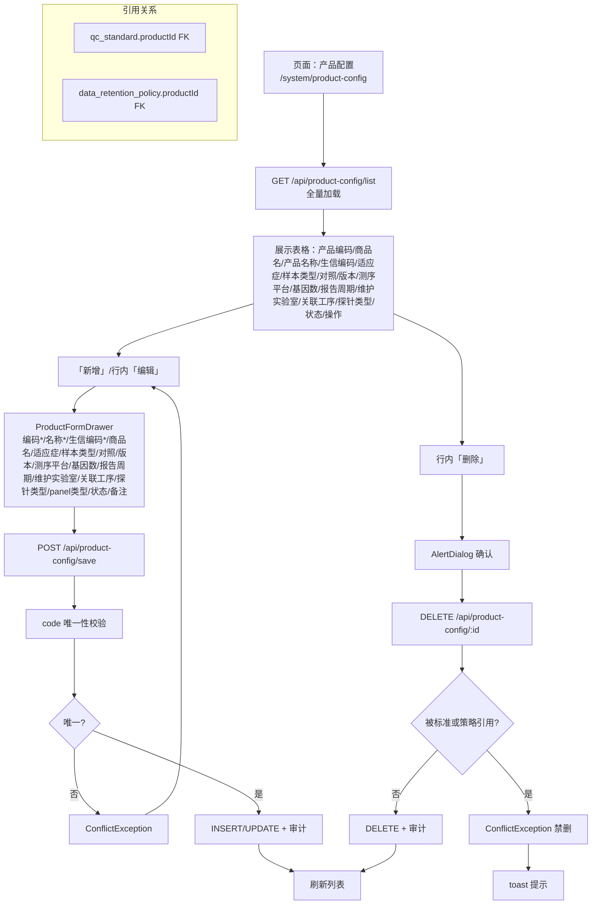

# 产品配置模块设计文档

> 路由：/system/product-config | 角色：operation_admin（管理） / 全部 4 角色（查看产品列表供下拉使用）

---

## 1. 数据模型

### product_config（产品配置表）

> 2026-10-22 列重排（迁移脚本 `script/sql/update/update_5.6.32-product-config-columns.sql`）：
> 原 `name` 一列同时被当生信编码和对外产品名用，现拆成 `product_bio` + `product_name`；`code` 改名 `product_code`。
> 2026-11-03 按产品配置图补齐字段（迁移脚本 `script/sql/update/update_5.6.51-product-config-refactor.sql`）。
> 下表已是落库后的实际结构。

| 字段 | 类型 | 约束 | 说明 |
|------|------|------|------|
| id | bigint | PK, AUTO_INCREMENT | 主键 |
| product_code | varchar(60) | NOT NULL, UNIQUE(tenant_id, product_code) | 产品编码（对外） |
| trade_name | varchar(120) | - | 商品名（诺卓康） |
| product_bio | varchar(120) | NOT NULL | 生信编码：逐字等于上传目录第 2 层 product / analysis_data.product_bio（驱动与报告定位靠它） |
| product_name | varchar(120) | NOT NULL | 产品名称（系统用） |
| related_diseases | varchar(500) | - | 适应症 |
| test_type | varchar(60) | - | 样本类型（组织 / 血液） |
| control_type | varchar(60) | - | 对照（血液 / PBMC / 无） |
| product_version | varchar(30) | - | 版本（LDT / IVD） |
| sequencing_platform | varchar(60) | - | 测序平台（surf5000 Dx） |
| gene_count | int | - | 基因数/DNA（1238） |
| report_cycle_days | int | - | 报告周期（天） |
| maintain_lab | varchar(60) | - | 维护实验室 |
| related_process | varchar(100) | - | 关联工序（全流程） |
| probe_type | varchar(120) | - | 探针类型（正常1238探针 / +UMI） |
| panel_type | varchar(60) | - | panel类型（DNA / RNA / DNA_RNA / WES / HRD 等；配置图里没有，冗余保留） |
| status | varchar(20) | NOT NULL, default 'active' | active / inactive |
| remark | varchar(500) | - | 备注 |
| _created_at / _created_by | - | 系统字段 | - |
| _updated_at / _updated_by | - | 系统字段 | - |

> 检测方式（来样即检 / 批量检测）不入库，业务默认「来样即检」；样本取材类型、去dup前测序深度、数据量本次不入表。

---

## 2. API 接口

| 方法 | 路径 | 权限 | 说明 |
|------|------|------|------|
| GET | /api/product-config/list | read:ProductConfig | 全量列表（支持 `activeOnly=true` 参数，报告页下拉取 active 产品） |
| POST | /api/product-config/save | manage:ProductConfig | 新增/更新（code 唯一校验） |
| DELETE | /api/product-config/:id | manage:ProductConfig | 删除（被 qc_standard 或 data_retention_policy 引用时 409 禁删） |

---

## 3. 业务逻辑

- **删除保护**：删除时检查 `qc_standard` 和 `data_retention_policy` 表中是否引用了该 product_id，有引用则抛 ConflictException
- **前端下拉**：报告管理/质控标准页面的产品下拉仅取 `activeOnly=true` 的活跃产品
- **自动判定桥接**：产品配置是 QC 自动判定链中的关键桥梁：`qc_record.subbarcode → sample_file.product_name → product_config.id → qc_standard.product_id`

---

## 4. 功能流程

---

## 5. 角色与权限

| 角色 | read:ProductConfig | manage:ProductConfig |
|------|:---:|:---:|
| wet_lab | ✅ | ❌ |
| bioinformatician | ✅ | ❌ |
| interpreter | ✅ | ❌ |
| operation_admin | ✅ | ✅ |