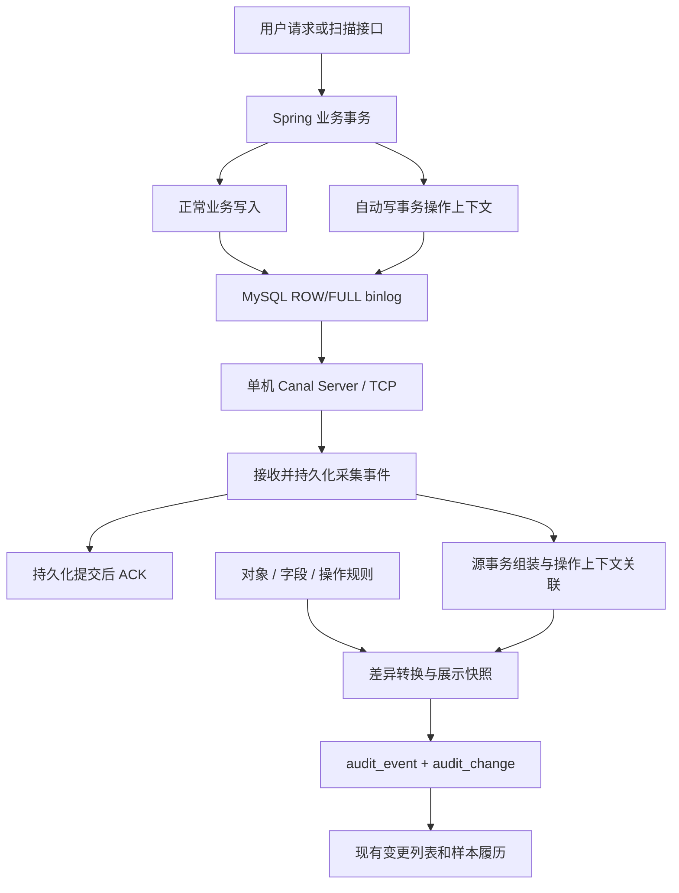
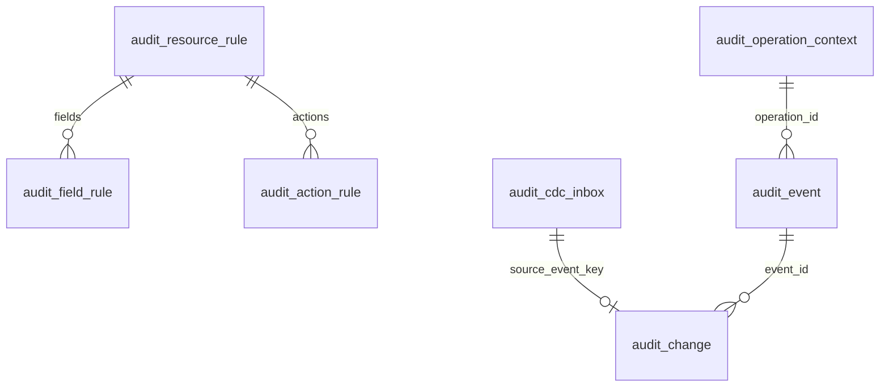

# Canal 数据审计架构与表设计草案

版本：V0.1；日期：2026-10-19；状态：供评审的设计草案，未批准、未实施。

本稿回答“业务操作名称如何对应、技术字段如何排除、原始字段和值如何翻译”，并展示总体架构。
只新增设计文档与独立 Java 映射示例，不创建数据库表，不接入 Canal，不替换现有业务写入。
新表名、字段和类名均为拟议；现有表和能力以当前仓库为依据。

## 1 依据与范围

- 既有审计表：`template-backend/script/sql/update/update_5.6.28-data-audit.sql`。
- 既有代码：`template-backend/ruoyi-modules/ruoyi-audit/`，包含 AuditRecorder、AuditWriter、AuditDiff。
- 公共规范：`ai-rules/04-db-schema.md`、`template-backend/AGENTS.md`。
- 翻译能力：`ruoyi-common-translation` 的字典、用户名、昵称翻译；报告状态以 ReportStatus 为准。
- 官方依据：[Canal ClientExample](https://github.com/alibaba/canal/wiki/ClientExample)、
  [Canal 配置源码](https://github.com/alibaba/canal/blob/master/deployer/src/main/resources/canal.properties)。

本期方案包含真实已提交行变化、身份关联、中文映射、字段过滤、恢复重放及只读展示。
不包含审计签批、历史回填、数据恢复按钮、数据库备份或高可用集群。
Canal 是增量采集组件；全量备份和连续 binlog 归档是独立建设项。

## 2 总体架构



接收与转换分开：先可靠保存，再确认；复杂业务映射失败可以重试，不使未持久化事件丢失。
单进程、单源顺序消费作为首期边界，不引入消息队列。Canal 游标和表结构历史也要持久化。
业务表、上下文表共同订阅；审计结果、缓冲和规则表不进入“业务变化”转换链。
规则表的变更通过受控发布过程记录，不允许因排除采集而失去配置变更记录。

## 3 表关系与公共约束

共 7 张逻辑表：新增 3 张配置表、2 张采集辅助表，修改现有 2 张审计结果表。



上述关系由应用校验，不建立指向可被删除业务行的级联外键。
上下文和最终事件不能仅靠 operation_id 跨药企无条件关联；须同时校验源事务及实际归属。
DDL 落地时采用以下共同约束，本稿逐表只列专有字段：

| 公共字段或约束 | 定义 |
| --- | --- |
| id | bigint NOT NULL AUTO_INCREMENT，单列主键 |
| tenant_id | varchar(20) NOT NULL DEFAULT '000000'，索引 idx_tenant_id |
| create_by / update_by | bigint NULL |
| create_time / update_time | datetime NULL |
| 存储与字符集 | InnoDB / utf8mb4 / utf8mb4_general_ci |
| 启停状态 | status varchar(20) NOT NULL DEFAULT 'active'，仅 active/inactive |
| 删除 | 审计、上下文和缓冲不加 del_flag；配置发布后不原位修改历史版本 |
| 唯一键 | 以 tenant_id 打头；不把样本编号当数据库记录唯一键 |

规则和缓冲首期统一属于平台空间 `__platform__`，只由内部组件和平台管理员访问。
上下文的 tenant_id 表示发起身份归属；另存 actor_tenant_id，明确其含义。
最终 audit_event、audit_change 的 tenant_id 来自被修改数据的实际归属，不能照抄操作人的药企。
全平台配置通过受控的平台读取路径加载，不给普通租户提供关闭采集的权限。
不为这批表随意增加租户白名单；内部跨租户查询使用已有 TenantContext 受控能力并校验归属。

## 4 配置表：业务名、字段过滤和翻译

### 4.1 audit_resource_rule：一张业务表的审计定义（新增）

| 字段 | 类型 | 约束及含义 |
| --- | --- | --- |
| resource_code | varchar(64) | NOT NULL；稳定业务对象编码，如 TENANT、REPORT |
| module_code / module_name | varchar(64) / varchar(100) | NOT NULL；模块编码与中文名 |
| source_code | varchar(64) | NOT NULL；受控源数据库实例编码 |
| schema_name / table_name | varchar(64) / varchar(64) | NOT NULL；真实库表名，启动校验元数据 |
| resource_name | varchar(100) | NOT NULL；药企、报告等中文对象名 |
| primary_keys_json | json | NOT NULL；有序完整主键，如 ["user_id","role_id"] |
| tenant_column | varchar(64) | NULL；直接归属列，没有时使用受控关联规则 |
| identity_mapping_json | json | NOT NULL；样本、分析、报告、文件等关联字段映射 |
| association_code | varchar(64) | NULL；只允许服务端实现的关联器编码，不接受 SQL/SpEL |
| rule_version | int | NOT NULL；正整数，发布后固定 |
| status | varchar(20) | NOT NULL DEFAULT 'active'；active/inactive |

唯一键：`uk_audit_resource_version (tenant_id, resource_code, rule_version)`。
辅助索引：`idx_audit_resource_table (tenant_id, source_code, schema_name, table_name)`。
发布时强制同源库表仅有一个有效版本；更新整套配置先校验、再一次性发布，禁止局部生效。
数据库注释只用于生成初稿，不能自动变成正式中文业务定义。

### 4.2 audit_field_rule：字段名称、记录策略、值翻译（新增）

| 字段 | 类型 | 约束及含义 |
| --- | --- | --- |
| resource_rule_id | bigint | NOT NULL；指向特定对象规则版本 |
| column_name | varchar(64) | NOT NULL；真实原始字段名 |
| field_label | varchar(100) | NOT NULL；中文字段名称 |
| capture_mode | varchar(16) | NOT NULL DEFAULT 'INCLUDE'；INCLUDE/IGNORE/SECRET |
| translation_type | varchar(24) | NOT NULL DEFAULT 'NONE'；NONE/DICT/ENUM/REFERENCE |
| translation_key | varchar(100) | NULL；字典类型或受控翻译器编码 |
| display_order | int | NOT NULL DEFAULT 0；展示顺序 |
| status | varchar(20) | NOT NULL DEFAULT 'active'；active/inactive |

唯一键：`uk_audit_field_column (tenant_id, resource_rule_id, column_name)`。
索引：`idx_audit_field_resource (tenant_id, resource_rule_id, display_order)`。
规则以 resource_rule_id 绑定完整版本，不另设彼此可能失配的字段版本号。

| 配置示意 | 字段名 | 中文名 | 记录策略 | 翻译 |
| --- | --- | --- | --- | --- |
| TENANT | tenant_name | 药企名称 | INCLUDE | NONE |
| TENANT | status | 启用状态 | INCLUDE | DICT / sys_normal_disable |
| TENANT | update_time | 更新时间 | IGNORE | NONE |
| REPORT | report_status | 报告状态 | INCLUDE | ENUM / 拟议 REPORT_STATUS 翻译器 |

全局技术字段默认排除 create_time、update_time、create_by、update_by。
SECRET 为不可被普通表配置覆盖的安全策略；凭证在持久化采集内容前移除。
IGNORE 表示不进入审计快照和字段差异，但主键、归属等必要身份元数据必须单独保留。
不可按名称包含 time/version 就整体排除：实验时间、审核时间、报告版本属于业务数据。
仅技术字段改变时不生成业务修改明细；同值导入等关键过程事实另行记录。
未配置的普通字段默认保留原名并发出待补映射提示；敏感字段是否准入必须先由安全策略判断。

### 4.3 audit_action_rule：操作名称派生规则（新增）

| 字段 | 类型 | 约束及含义 |
| --- | --- | --- |
| resource_rule_id | bigint | NOT NULL；指向特定对象规则版本 |
| action_code / action_name | varchar(64) / varchar(100) | NOT NULL；稳定操作编码及中文名称 |
| change_type | varchar(24) | NOT NULL；CREATE/UPDATE/DELETE/SOFT_DELETE/RESTORE |
| match_mode | varchar(24) | NOT NULL；DEFAULT 或 CHANGED_FIELD_TO_VALUE |
| field_name | varchar(64) | NULL；只允许该表已校验的字段 |
| expected_after_json | json | NULL；保留值类型，不能把数字、字符串随意混用 |
| priority | int | NOT NULL DEFAULT 100；数值小者优先，冲突在发布时拒绝 |
| status | varchar(20) | NOT NULL DEFAULT 'active'；active/inactive |

唯一键：`uk_audit_action_code (tenant_id, resource_rule_id, action_code)`。
索引：`idx_audit_action_match (tenant_id, resource_rule_id, change_type, priority)`。

| 对象 | 动作 | 条件 | 结果名称 |
| --- | --- | --- | --- |
| TENANT | CREATE | 默认 | 药企新增 |
| TENANT | UPDATE | status 真正变化且新值为字符串 "1" | 药企停用 |
| TENANT | UPDATE | 默认 | 药企信息修改 |
| TENANT | DELETE | 默认 | 药企删除 |
| REPORT | UPDATE | 默认 | 报告数据修改 |

名称优先级：可信上下文 action_code → 明确字段变化规则 → 对象默认动作。
上下文动作以稳定编码白名单解释，不能接受客户端任意文本成为审计结论。
status 已为停用而只改备注，不能再次命名“药企停用”。
报告“审核通过/驳回”等真实意图优先取上下文，不能只根据最终状态自动推断。
整事务的业务操作与各行的数据动作分别保存：一个审核事务可以产生多条不同对象的变化。
工作流状态按源表原有定义解释；本稿不把 sys_tenant 的既有 0/1 改成 active/inactive。

## 5 采集辅助表

### 5.1 audit_operation_context：同事务操作背景（新增）

| 字段 | 类型 | 约束及含义 |
| --- | --- | --- |
| operation_id | char(32) | NOT NULL；每个实际业务事务的操作编号 |
| request_id | char(32) | NULL；串联一次请求中的多个独立事务 |
| actor_id / actor_name | varchar(100) / varchar(120) | NOT NULL；可信身份及当时姓名 |
| actor_tenant_id | varchar(20) | NOT NULL；发起身份所属药企，与数据归属分开 |
| action_code | varchar(64) | NULL；无法确定具体动作时使用默认规则 |
| source_type / source_code | varchar(24) / varchar(64) | NOT NULL；USER/SERVICE 及执行服务编码 |
| task_id | varchar(128) | NULL；扫描或后台任务编号 |
| reason | varchar(1000) | NULL；适用时由业务提供更正原因 |
| identity_snapshot_json | json | NULL；必要身份和业务名称快照，禁止凭证 |
| occurred_at | datetime(3) | NOT NULL；服务端动作时间 |

唯一键：`uk_audit_context_operation (tenant_id, operation_id)`。
索引：`idx_audit_context_request (tenant_id, request_id)`。
仅公共事务组件写入，无公开“任意指定操作人”的接口；事务回滚时该行共同回滚。
请求上下文不等于事务上下文：REQUIRES_NEW、异步任务、导入每行事务分别登记。
必须在注册同步回调的有效时机绑定事务，不在事务结束后或同库另开独立事务补写。
不在每个业务方法添加审计注解；业务仍保留原有事务语义。
自动登记覆盖范围、嵌套保存点、只读事务及无显式事务写入是前置验证项，尚未实现。

### 5.2 audit_cdc_inbox：可靠接收与重放（新增）

| 字段 | 类型 | 约束及含义 |
| --- | --- | --- |
| source_code / source_epoch | varchar(64) / varchar(64) | NOT NULL；源实例及其世代，防重建后位点碰撞 |
| source_event_key | char(64) | NOT NULL；稳定元数据规范化后 SHA-256，小写十六进制 |
| source_tx_key | varchar(180) | NULL；验证过的源事务标识，不能使用客户端 batchId |
| entry_kind | varchar(24) | NOT NULL；ROW/BEGIN/END/DDL/GTID 等 |
| schema_name / table_name | varchar(64) / varchar(64) | NULL；事务元事件可为空 |
| binlog_file | varchar(128) | NOT NULL；源 binlog 文件 |
| binlog_position | bigint | NOT NULL；源事件位置 |
| source_row_no | int | NOT NULL；同事件内行序号，不是对象主键 |
| source_time | datetime(3) | NULL；源事件时间，不混同采集时间 |
| captured_at | datetime(3) | NOT NULL；首次可靠接收时间 |
| resource_rule_id | bigint | NULL；已绑定的规则版本；事务元事件可为空 |
| sanitized_payload_json | json | NOT NULL；经过凭证移除的受控数据，非任意原始报文 |
| process_state | varchar(24) | NOT NULL DEFAULT 'NEW'；NEW/WAITING/DONE/ERROR |
| retry_count | int | NOT NULL DEFAULT 0 |
| last_error | varchar(1000) | NULL；脱敏错误摘要 |

唯一键：`uk_audit_inbox_source (tenant_id, source_event_key)`。
索引：`idx_audit_inbox_state (tenant_id, process_state, id)`、
`idx_audit_inbox_tx (tenant_id, source_tx_key, id)`。
source_event_key 至少涵盖源实例世代、文件、位置、行序号和事件类型；主键变化也保留原值。
GTID 可用于源事务归组；不能在未验证时把某个头字段、线程号或投递分段当成真实事务唯一键。
凭证移除是采集前置策略，不得把包含凭证的原始 SQL/报文整体写入该表。
处理失败不跳过；缺上下文时可靠暂存，等待源事务完成后再判断是否真正缺失。
元数据事件与事务边界也要持久化，不能只保存业务 ROW。

## 6 现有结果表如何扩展

不修改已发布的 update_5.6.28-data-audit.sql；未来实现时新增幂等迁移。

### 6.1 audit_event：复用，拟增加

| 新增字段 | 类型 | 用途 |
| --- | --- | --- |
| event_key | char(64) | NULL（兼容旧记录）；源事务＋业务归属＋事件分组的稳定键 |
| request_id | char(32) | NULL；请求关联 |
| source_tx_key | varchar(180) | NULL；源事务关联 |
| action_code | varchar(64) | NULL；操作编码，旧 action 字段继续保存当时中文名称 |
| action_name_source | varchar(16) | NULL；CONTEXT/RULE/DEFAULT |
| module_code / module_name | varchar(64) / varchar(100) | NULL；当时模块信息 |
| reason | varchar(1000) | NULL；更正原因 |
| capture_type | varchar(16) | NULL；CDC/PROCESS/LEGACY |
| received_at | datetime(3) | NULL；审计可用时间，与 occurred_at 区分 |

增加唯一键 `uk_audit_event_source (tenant_id, event_key)`；旧记录的 NULL 不回填伪造源位置。
actor_id 无法关联时使用明确的 UNATTRIBUTED 标识，不能猜成某个用户或 SYSTEM。
样本/分析/报告关系沿用现有字段；一个跨药企事务按实际数据归属拆成多个事件。
药企归属本身改变时保留双方历史关系，授权规则应单独评审，不能只记录新归属而泄露旧租户数据。

### 6.2 audit_change：复用，拟增加

| 新增字段 | 类型 | 用途 |
| --- | --- | --- |
| source_event_key | char(64) | NULL；与采集行关联，兼容旧数据 |
| resource_code / resource_name | varchar(64) / varchar(100) | NULL；对象编码及当时名称 |
| resource_rule_id | bigint | NULL；使用的规则版本 |

增加唯一键 `uk_audit_change_source (tenant_id, source_event_key)`；单源行事件仅转一条审计明细。
保留 table_name、完整 object_key、before_json、after_json，不用中文覆盖原始值。
changed_fields_json 的拟议内容：

```json
[
  {
    "field": "report_status",
    "label": "报告状态",
    "before": 32,
    "after": 33,
    "beforeDisplay": "报告生成成功（32）",
    "afterDisplay": "报告生成失败（33）",
    "translationSource": "ENUM_SNAPSHOT"
  }
]
```

数据示意，不代表发生过这次业务变更。前端默认展示字段、修改前、修改后三列，技术详情可展开。
记录不存在、字段值 null、空字符串分别处理，新增/删除不能全部显示成“未填写”。
配置和翻译版本在首次处理时固定；重试不得因配置改动而悄悄生成不同结论。

## 7 代码落位与调用顺序（拟议）

以下树在现有 `ruoyi-audit/src/main/java/org/dromara/audit/` 内新增；并非已经存在的文件。

```text
config/
  AuditCanalConfiguration.java           Canal 连接与消费生命周期配置
canal/
  CanalAuditConsumer.java                拉取、入库后确认、失败重试
  CanalEntryDecoder.java                 协议解码、稳定事件标识、凭证移除
context/
  AuditTransactionSynchronization.java   同事务登记操作上下文（前置验证项）
domain/dto/
  CdcRowChange.java / AuditOperationContext.java / AuditDisplayField.java
mapper/
  AuditResourceRuleMapper.java / AuditFieldRuleMapper.java / AuditActionRuleMapper.java
  AuditOperationContextMapper.java / AuditCdcInboxMapper.java
service/impl/cdc/                        域内协作类超过四个，按现有规范落位
  AuditInboxReceiver.java
  AuditTransactionAssembler.java
  AuditRuleResolver.java
  AuditChangeConverter.java
  AuditValueTranslator.java
```

既有 AuditDiff 继续处理语义比较；AuditWriter 改成接收已组装的变化。
既有审计查询 Controller/Service 保留，VO 增加结构化展示信息。
所有 SQL 放 Mapper XML，不在 Java 的 Service 中拼 SQL。
引用字典、用户名等已有服务；若报告枚举需要扩展翻译，使用已有 TranslationInterface 扩展机制，
由报告模块提供 REPORT_STATUS 翻译实现，避免 audit 反向依赖 report 造成循环依赖。
现有 @Translation 作用于 VO 属性，不会自动递归翻译 changed_fields_json，需显式转换。

### 7.1 消费伪代码（说明顺序，非已实现的方法或可执行交付）

```text
message = Canal.getWithoutAck()
entries = 解码(message)，保留源事务边界
在本地事务中：
    按 source_event_key 幂等保存受控事件到 inbox
提交该本地事务
Canal.ack(message.batchId)

后台转换：
    从 inbox 还原完整源事务（可能跨多个消费批次）
    关联该源事务的操作上下文
    固定规则版本，解析数据归属与样本关系
    排除技术和敏感字段；生成操作名称、字段差异和展示快照
    在同一本地事务中：
        幂等写 audit_event、audit_change
        把对应 inbox 记录标记 DONE
    提交；失败则保持可重试状态
```

不能照抄官方演示跳过 TRANSACTIONBEGIN/END，也不能在仅存在内存时确认消费。
Canal 大事务可能分段投递，真实事务识别能力及可恢复性必须先验证，不能靠“相近时间”配身份。
完整已提交事务确定没有上下文时，保存 UNATTRIBUTED 并告警，不无限等待或虚构操作者。
因为上下文未产生、行数据缺失、规则无效而无法转换时，记录明确处理状态和待处理原因。

### 7.2 操作命名、过滤及翻译

```text
输入：已解码的一条记录前后值＋已验证的上下文＋固定版本规则
操作名：可信 action_code → 字段确实变化且匹配规则 → 默认对象动作
字段：身份信息另存；SECRET 剔除；IGNORE 剔除；其余做语义比较
翻译：字段中文名＋NONE/DICT/ENUM/REFERENCE
输出：原始事实＋当时展示快照＋规则来源
```

数值精度、布尔、日期、JSON、二进制的转换按源类型定义；不能把所有值 stringify 后比较。
下面独立示例只演示 UPDATE、简单字典/枚举及 BigDecimal 等值判断，不覆盖完整类型矩阵。
生产版不靠字段名猜密码：敏感字段准入与深层结构过滤需结合既有 AuditDiff 完善并验收。

历史名称不能依靠消费时查询当前字典/用户表后就宣称“当时名称”。
静态文案保存映射版本；关键关联名称来自可信上下文或带版本的历史映射。
只拿到当前名称时标记 CURRENT_REFERENCE；翻译失败保存原值并显示 UNKNOWN，不中断基础采集。
关联查询按源数据租户批量执行，禁止 N+1 查询和不带租户的任意 ID 翻译。

## 8 独立可运行示例

文件：[examples/CanalAuditMappingDemo.java](examples/CanalAuditMappingDemo.java)。
Java 17 单文件运行，不依赖 Maven 或第三方库；配置对象是表数据加载后的内存形态示意，
不代表访问过真实配置表。access_token 是安全测试用的示例列，不代表源表存在该列。
示例使用占位值而非真实凭证；对象主键和字段值也仅为明确标注的测试输入。

预期边界：

| 输入 | 预期 |
| --- | --- |
| 药企状态 0→1，同时 update_time 变化 | 一条业务字段差异；操作“药企停用” |
| 只修改 update_time | 无业务字段差异 |
| 备注 文本→null / null→空字符串 | 分别保留清空和空字符串语义 |
| 报告状态 32→999 | 保留 999 并显示未知编码 |
| 状态已是 1，只改备注 | 不再次判为药企停用 |
| 上下文存在、动作编码为 null | 回退字段规则或默认动作，不抛空指针异常 |

在仓库根目录用 PowerShell 运行（java 必须为 17 或更高，-ea 必须保留）：

```powershell
java -ea 'docs/modules/sample-audit/examples/CanalAuditMappingDemo.java'
```

预期最后打印 `CANAL_AUDIT_MAPPING_DEMO: PASS (17 assertions)`；此处为预期，真实结果见交付报告。
这 17 项断言仅验证映射示例，不能据此宣称数据库、Canal、身份关联或故障恢复已验证。
独立断言示例按仓库要求使用标准输出打印 PASS/FAIL，不引入 SLF4J；可读性闸门的
4 条 print-debug 提示属于该用途，生产消费者应使用项目日志组件。

## 9 实施验收与切换

1. 先对 sys_tenant、sample_file、analysis_report 验证采集与同事务身份关联。
2. 覆盖跨批次、大事务、REQUIRES_NEW、保存点回滚、无显式事务写入、逐行导入。
3. 杀进程测试三处故障：inbox 提交前、提交后 ACK 前、结果事务提交前；重放不丢不重。
4. 验证字段过滤、中文状态、未知值、清空值及历史名称，不把参考名称标成历史事实。
5. 验证多药企、多报告、多文件及删除后履历；实际归属无法确定时隔离待处理，不开放平台可见。
6. 首期单消费所有权；后端多实例部署时只能一个活动消费者，不能随服务副本重复启动。
7. 保留关键过程事件（同值导入、驱动发起等）；不能把现有 process 调用一律删除。
8. 新旧机制先在隔离环境比对，随后影子采集；按源位点界定正式切换窗口，避免重复与缺口。
9. 监控断连、采集延迟、ERROR/WAITING、未关联身份和 binlog 保留窗口；位点丢失不得自动跳最新。
10. 上线另交新迁移、源版本兼容清单、可读性/结构/数据库闸门、独立评审与真实集成测试结果。

## 10 待评审事项

- 这是可靠版的 7 表方案；新增配置表首期可由受控脚本管理，不增加配置 CRUD 页面。
- 关键字段、更正原因必填场景、显示名称和保留期限需业务与质量确认；本稿不伪造批准。
- 公共事务上下文自动登记与 Canal 真实事务关联是最高风险验证项，未通过前不开展全量替换。
- Canal/MySQL/JDK 版本、库大小、峰值写入量、实际审计延迟及资源占用尚未实测。
- 原始位点大批量导入的记录范围、附件证据保留和源身份，需要单独确定；不能简单关闭而丢失追溯。
- 库表名真实大小写必须原样匹配；已有大写位点表不能按新表命名规范擅自改名。
- 本稿只给逻辑设计与关键约束；无已执行 DDL、无生产消费者、无已上线结论。

## 11 本轮实际验证记录

2026-10-19，使用本机已有 JDK 17 执行以下命令，未改变默认 Java 8 环境：

```powershell
& 'D:\soft\scoop\global\apps\openjdk17\current\bin\java.exe' '-Dfile.encoding=UTF-8' -ea 'docs/modules/sample-audit/examples/CanalAuditMappingDemo.java'
```

真实输出末尾：

```text
PASS null_action_code_uses_field_rule
PASS null_action_code_uses_default
EXAMPLE 药企停用 | 启用状态 | 正常（0） -> 停用（1）
CANAL_AUDIT_MAPPING_DEMO: PASS (17 assertions)
```

本次改动可读性 error 0 / warn 4，均为独立自测的标准输出；页面结构检查因未改前端跳过。
origin/main 在当前仓库不存在；按真实 origin/master 补跑，分支可读性 error 0 / warn 93，
包含历史分支提示及本示例 4 条输出提示；结构扫描 13 个文件，error 0 / warn 0。
独立只读评审发现并修复了空 action_code 导致不可变 Map 查询抛空指针的问题，复核通过。
尚未执行数据库建表、Canal 集成、事务身份关联和故障恢复测试，不把示例结果当作这些验证。
